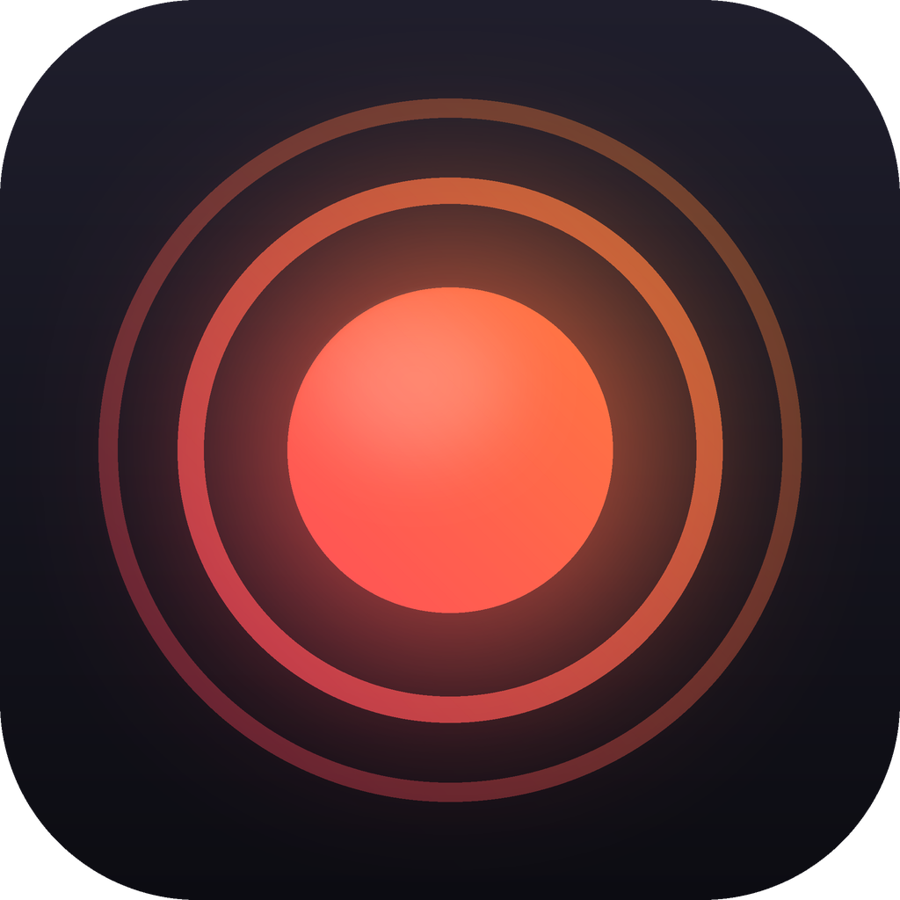
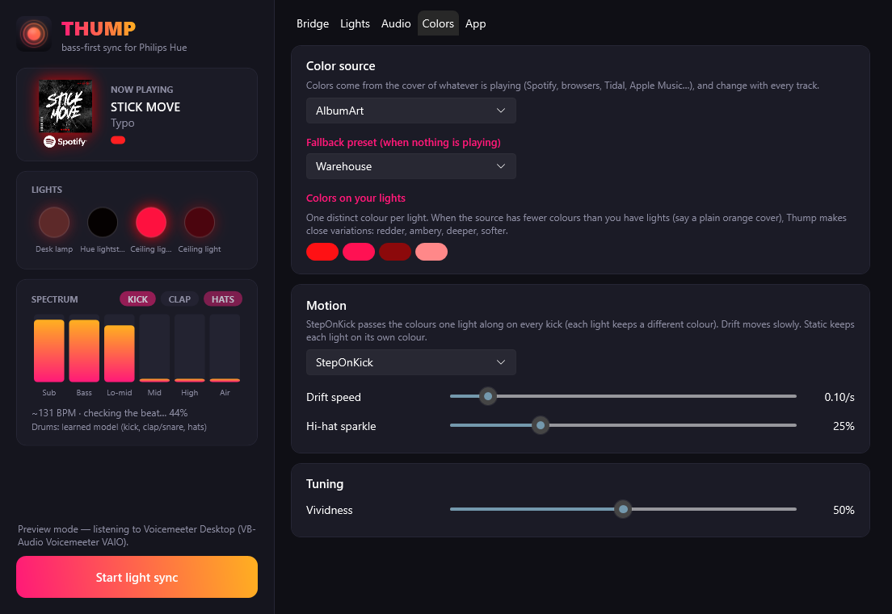

<p align="center"></p>

<h1 align="center">Thump</h1>

<p align="center"><b>Bass-first music and screen sync for Philips Hue, for Windows 10/11.</b></p>

<p align="center"></p>

Hue Sync's music mode is tuned for "average" music: it blends the whole spectrum into one loudness value. That's
fine for pop, but on techno and house the lights end up following hats and synths instead of the thing you actually
feel: the kick and the sub. Thump is built the other way round.

- **Bass-first audio engine.** The spectrum is split into six bands (sub, bass, low-mid, mid, high, air). Each band
  levels itself automatically, and you decide how much each one drives the lights. The defaults lean hard on the low end.
- **A kick detector that learns each track.** A small per-song model learns, while the track plays:
  - how hard *this* track's kick hits (quiet and loud kicks both work),
  - what it *sounds* like (a spectral fingerprint, compared against hits that turned out not to be kicks, such as
    rolling basslines and claps),
  - the **tempo**, followed continuously so DJ pitch-riding, tempo ramps and hard tempo cuts are tracked,
  - the **rhythm pattern**: which 16th notes carry kicks, so four-on-the-floor and broken beats both work.

  It starts over on every track change and survives breakdowns. No training data, no model files. It's a few hundred
  lines of C#.
- **Per-light roles.** Put a light on *Kick* for a hard pulse, others on *Bass*, *Mix*, *Mids*, *Highs* or *Ambient*.
- **Album-art colours (the default).** Uses the cover of whatever's playing (Spotify, browsers, Apple Music, Tidal,
  foobar2000, anything that shows up in Windows' media overlay) and changes with every track. **Every light gets its own
  colour.** When a cover has fewer colours than you have lights (a plain orange cover with 4 lights, say), Thump
  derives close variations: orange, red-orange, deep orange, soft orange.
- **Screen colours.** Each light copies the part of the screen it sits next to. The music can still drive brightness.
- **Presets and custom palettes**, with colour stepping on every kick, slow drift or static colours, plus an optional
  hi-hat "sparkle".
- **Hue Entertainment API streaming** (DTLS, ~50 updates/s), the same low-latency path Hue Sync uses.

> Thump is an independent open-source project. It is not affiliated with or endorsed by Philips or Signify.
> "Philips Hue" and "Hue Sync" are trademarks of Signify.

## Download

Grab **`Thump-x.y.z.msi`** from the [latest release](../../releases/latest) and run it. It installs just for you
(no admin prompt) into `%LocalAppData%\Programs\Thump`, adds a Start menu shortcut, and can be removed from
*Settings → Apps*. Prefer no installer? `Thump-win-x64-portable.zip` has the same app as a single exe.

Windows SmartScreen may warn because the installer isn't code-signed yet. Choose *More info → Run anyway*, or build
it yourself.

### Runs in the background

Closing the window doesn't stop Thump: it keeps your lights syncing from the notification area (system tray).
Right-click the tray icon to start or stop syncing, or to quit. On the **App** tab you can turn on:

- **Start with Windows**: starts hidden in the tray when you sign in.
- **Automatically connect**: connects to your entertainment area and starts syncing as soon as Thump starts.
- **Updates**: off unless you enable them. Thump checks this repository's GitHub releases every few hours,
  downloads the new installer, verifies its SHA-256 checksum against the one GitHub publishes, and either asks you or
  (if you opt in) installs it automatically when the lights aren't syncing.

## Setup

1. **Create an entertainment area** in the official Hue app (*Settings → Entertainment areas*) and place the lights
   where they really are. Screen mode uses these positions.
2. Open Thump → **Bridge** tab → *Discover* (or type the bridge IP) → *Pair with bridge*, then press the link
   button on the bridge within 30 seconds.
3. Pick the entertainment area, set up roles on the **Lights** tab, then hit **Start light sync**.

Only one app can stream to an entertainment area at a time, so close Hue Sync first.

## Tuning tips (techno / house)

| Want | Do |
|---|---|
| Lights locked to the kick, dark in between | Set the main lights to *Kick*, raise **Contrast**, lower **Release** |
| Rumbling sub that "breathes" | *Bass* role, **Sub** weight up, **Release** ~300 ms |
| Kicks being missed | Raise **Kick sensitivity** a little |
| Bassline triggering kicks | Lower **Kick sensitivity** |
| Less flicker on dense tracks | Raise **Attack** to 30–50 ms |

The live panel shows the spectrum, a kick LED, the tempo it's following and "locked" once the beat grid is solid.

## Building from source

Requirements: Windows 10 2004+ and the [.NET 10 SDK](https://dotnet.microsoft.com/download).

```bash
git clone https://github.com/Lancito01/thump.git
cd thump
dotnet run --project src/Thump
```

Tests (synthetic techno loops with tempo ramps, breakdowns, broken beats and soft kicks):

```bash
dotnet test
```

To see what the analyzer makes of a real track, record it to a WAV and run the bench:

```bash
THUMP_WAV=path/to/track.wav dotnet test --filter RealMusicBench --logger "console;verbosity=detailed"
```

Release build (single self-contained exe, then the per-user MSI; needs nothing beyond the .NET SDK, WiX comes from NuGet):

```bash
dotnet publish src/Thump -c Release -r win-x64 --self-contained -p:PublishSingleFile=true -p:IncludeNativeLibrariesForSelfExtract=true -o publish
dotnet build installer -c Release -p:Version=0.2.1
```

Pushing a `v*` tag does all of this on GitHub Actions and publishes the release.

## How it works

```
WASAPI loopback ─▶ FFT (2048, hop 512) ─▶ 6 auto-levelled bands ─────────────┐
                                     └──▶ KickDetector (per-song model) ─────┤
Media session (album art) ─▶ palette extraction ──────────────────────────────┤──▶ SyncEngine (50 Hz) ─▶ DTLS ─▶ Hue bridge
Screen (GDI, 64×36) ─▶ per-light sampling by entertainment position ─────────┘
```

| File | What it does |
|---|---|
| `Audio/AudioAnalyzer.cs` | Loopback capture, FFT, per-band adaptive levels |
| `Audio/KickDetector.cs` | The per-song kick model: strength, timbre templates, tempo following, rhythm slots |
| `Colors/AlbumArtSource.cs` | Now-playing info and cover art via Windows' media session API |
| `Colors/Palettes.cs` | Presets and vivid-colour extraction from images |
| `Colors/ScreenSampler.cs` | Cheap downscaled screen capture |
| `Hue/HueBridgeClient.cs` | Discovery, pairing, entertainment areas (CLIP v2) |
| `Hue/EntertainmentStreamer.cs` | HueStream v2 over DTLS 1.2 PSK (BouncyCastle) |
| `SyncEngine.cs` | The 50 Hz loop: features + colours → per-light output |
| `TrayIcon.cs`, `Startup.cs` | Tray icon, start with Windows |
| `Updater.cs` | Opt-in updates from GitHub Releases (checksum-verified MSI) |
| `installer/` | WiX per-user MSI |

Settings, including the bridge credentials, live in `%APPDATA%\Thump\settings.json`.

## Known limitations

- If a bassline is genuinely *louder* than the kick inside the 40–130 Hz band, the kick can still be missed. The
  sensitivity slider helps.
- Screen mode uses GDI capture: exclusive-fullscreen games and DRM-protected video may show up black (use borderless).
- Only the primary monitor is sampled.

## Contributing

Issues and PRs welcome. If a track fools the kick detector, a short WAV clip and a note on what went wrong is the most
useful bug report.

## License

[MIT](LICENSE)
